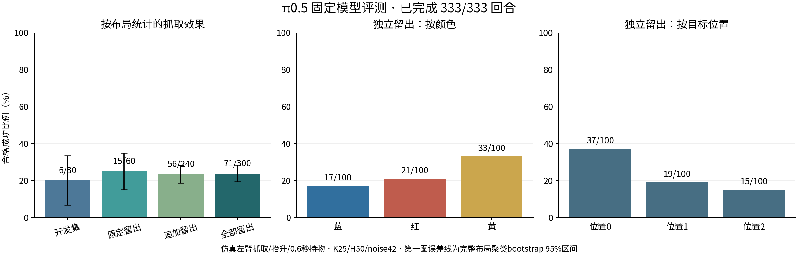

# 当前 π0.5 模型性能评测 · 2026-11-16

更新：2026-11-16T20:09:27.519235+08:00。已完成 333/333 回合，运行异常 0，未完成 0。

**固定模型：three_targets/5744；K=25、H=50、固定 noise42；无新增训练。**

**当前结论：**全部独立留出已完成 300 回合，合格成功 71 回合（23.7%）。模型具备部分抓取能力，但当前成功率不足以视为可靠操作策略。

首批93回合使用两个worker，补充240回合在执行前根据显存与吞吐调整为三个worker；策略、控制器和判据不变。并发数与模型/代码哈希均保存在协议中。

测试任务为仿真左臂抓取—抬升—持物。合格要求：抬升超过5cm、测得夹爪开度8%–90%、至少2/3手指接触目标、右臂不接触目标，连续至少0.6秒，并且无终止异常及非预定接触。达到阈值即停止，不代表长时间持物、双臂交接或真机性能。

| 分组 | 合格成功/完成回合 | 成功比例 | 完整布局 | 按布局聚类的95%区间 |
|---|---:|---:|---:|---|
| 训练布局复现 | 1/3 | 33.3% | 1 | 样本或变异不足，不估计 |
| 开发集 | 6/30 | 20.0% | 10 | 6.7%–33.3% |
| 原定独立留出集 | 15/60 | 25.0% | 20 | 15.0%–35.0% |
| 追加独立留出集 | 56/240 | 23.3% | 80 | 18.7%–28.3% |
| 全部独立留出集 | 71/300 | 23.7% | 100 | 19.3%–28.0% |

原定独立留出集为布局2000–2019；依据吞吐预登记追加2020–2099，分别统计并汇总。两批在本次固定模型前未使用；本轮不依据该集调参。开发1000曾参与历史方案选择，开发1001–1009此前未参与该选择。训练布局0仅作复现，不能合并计算泛化成功率。

## 颜色与目标位置

| 分组 | 蓝 | 红 | 黄 | 位置0 | 位置1 | 位置2 |
|---|---:|---:|---:|---:|---:|---:|
| 训练布局复现 | 1/1 | 0/1 | 0/1 | 1/1 | 0/1 | 0/1 |
| 开发集 | 1/10 | 1/10 | 4/10 | 3/10 | 2/10 | 1/10 |
| 原定独立留出集 | 4/20 | 6/20 | 5/20 | 9/20 | 4/20 | 2/20 |
| 追加独立留出集 | 13/80 | 15/80 | 28/80 | 28/80 | 15/80 | 13/80 |
| 全部独立留出集 | 17/100 | 21/100 | 33/100 | 37/100 | 19/100 | 15/100 |

### 全部独立留出：颜色 × 位置

| 颜色 | 位置0 | 位置1 | 位置2 |
|---|---:|---:|---:|
| 蓝 | 9/30 | 7/30 | 1/40 |
| 红 | 13/39 | 2/31 | 6/30 |
| 黄 | 15/31 | 10/39 | 8/30 |

每个布局三种颜色各出现一次；target表示固定空间槽位，颜色会随布局置换。位置0约(-0.58,0.18)m、位置1约(-0.42,0.32)m、位置2约(-0.10,0.32)m，均有预定位置/尺寸/yaw变化。分色95% Wilson区间在summary.json，整体区间使用完整布局为单位的20000次bootstrap，避免把同布局三回合当完全独立样本。如果存在部分布局，总比例保留所有完成回合，区间仅对应完整布局；该子集均值见complete_layout_mean。该区间只反映本场景生成分布及固定噪声下的抽样不确定性。

## 失败与完整性

- 训练布局复现：{"empty_grasp": 2}；有非预定接触 0 回合，其中非目标接触 0 回合。
- 开发集：{"empty_grasp": 19, "step_budget_exhausted": 5}；有非预定接触 4 回合，其中非目标接触 3 回合。
- 原定独立留出集：{"empty_grasp": 37, "step_budget_exhausted": 8}；有非预定接触 5 回合，其中非目标接触 1 回合。
- 追加独立留出集：{"empty_grasp": 156, "step_budget_exhausted": 28}；有非预定接触 27 回合，其中非目标接触 9 回合。
- 全部独立留出集：{"empty_grasp": 193, "step_budget_exhausted": 36}；有非预定接触 32 回合，其中非目标接触 10 回合。

已完成 333 份逐250Hz物理证据复核，保存全部成功与失败。运行异常不悄悄删除，不作为普通策略失败；如有部分布局或时间截断，见summary.json的uncompleted及operational_errors。

## 闭爪阶段的描述性证据

在发出过闭爪指令的独立留出回合中，首次闭爪指令时工具中心到目标中心的水平距离中位数：成功组 1.60 cm（71回合），失败组 5.09 cm（193回合）。未发出闭爪指令的回合不计入该距离统计。

这提示应优先检查末段接近、物体位移后的恢复以及闭爪时机，但属于不同场景与轨迹之间的相关性；目标可能已被推动，工具中心距离也不等于完整夹持几何误差，不能据此确定唯一根因。分位数与目标移动证据见failure_diagnostics.json。

## 历史结果复现与解释边界

11月12日训练布局0为1/3、开发1000为2/3；本次同布局分别为1/3、1/3，蓝块开发案例未复现成功。已核对开发1000蓝块的首次输入：14维状态、三路RGB和固定噪声逐值相同，但首次动作最大绝对差约0.001895。差异原因尚未隔离，不能声称跨进程逐数值确定性，也不能仅据此认定失败根因。旧回合不并入本轮独立留出统计。完整输入核查见initial_observation_audit.json。

本轮没有对每个新留出布局另跑专家可达性对照；结果反映固定场景生成分布上的策略表现，尚不能把全部失败都归为单一学习缺陷。

当前模型在已有stage3/14854权重上，以布局0三条示教1170帧再优化5744步；5744不是从零训练的累计总步数。当前结果衡量这一固定检查点，不能作为扩数据或某个训练改动的因果收益。

## 查看与复现

[汇报版PDF](../reviews/2026-11-16/JAKA_pi05_性能评测报告.pdf) · [成功与失败Demo](../reviews/2026-11-16/demo_success_and_failure.mp4)（说明案例，不代表成功比例）。

下载并解压[全部录像查看包](../reviews/2026-11-16/JAKA_pi05_评测与全部视频_20261116.zip)，打开review/index.html，可按分组、颜色、成功/失败筛选全部录像；[results.csv](../reviews/2026-11-16/results.csv)为逐回合表，[summary.json](../reviews/2026-11-16/summary.json)含完整统计，[protocol.json](../reviews/2026-11-16/protocol.json)含预注册场景清单、固定参数和模型/代码哈希。

高清多视角录像在执行前按布局ID固定选择；其余保留真实评测头部相机视频。视频为25Hz仿真时间，高清片头2秒/片尾3秒标记为静帧；不代表实际推理延迟。未进行模型优劣、训练改进、语言作用消融或Sim2Real结论验证。
